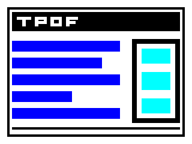

# Orthogonal raster demo

`orthogonal-demo.content` is a standalone 320 × 240 PDF path program. Its block
lettering is made from rectangles; it does not exercise font rendering. It
includes compound even-odd fill and nested clipping in opaque endpoint colors.

From the engine directory:

```sh
cargo build --locked --features raster
./target/debug/pdf-inspect --raster=320x240 examples/orthogonal-demo.content > /tmp/tandem-demo.ppm
/path/to/mupdf-raster-oracle 320 240 < examples/orthogonal-demo.content > /tmp/tandem-demo-native.ppm
cmp /tmp/tandem-demo.ppm /tmp/tandem-demo-native.ppm
```

The exact P6 PPM SHA-256 from both implementations is
`9f89f4cbbad359a599a126b355347762a2fbbc907489cb02fb1e4bac7d931553`.
`orthogonal-demo.png` is a lossless RGB PNG encoding of that same Rust output,
provided for preview. The native oracle is built from the pinned MuPDF source;
see `tools/build-raster-reference.sh` and its recorded provenance.




# Standalone text-position trace

`text-position.content` and `text-position.fonts` demonstrate two explicit
builtin advance policies. Reproduce the complete owned trace with:

```sh
./target/debug/pdf-inspect --text=examples/text-position.fonts examples/text-position.content > /tmp/tandem-text-position.json
```

`text-position.json` records 36 source-code placements and a numeric TJ
adjustment. It preserves each enclosing operation span, decoded-string offset,
Unicode byte span, font policy, advance and transform. No newline is invented
between separate text lines: this trace does not infer reading order or text
layout. These are source-code positions, not rendered glyph outlines.
